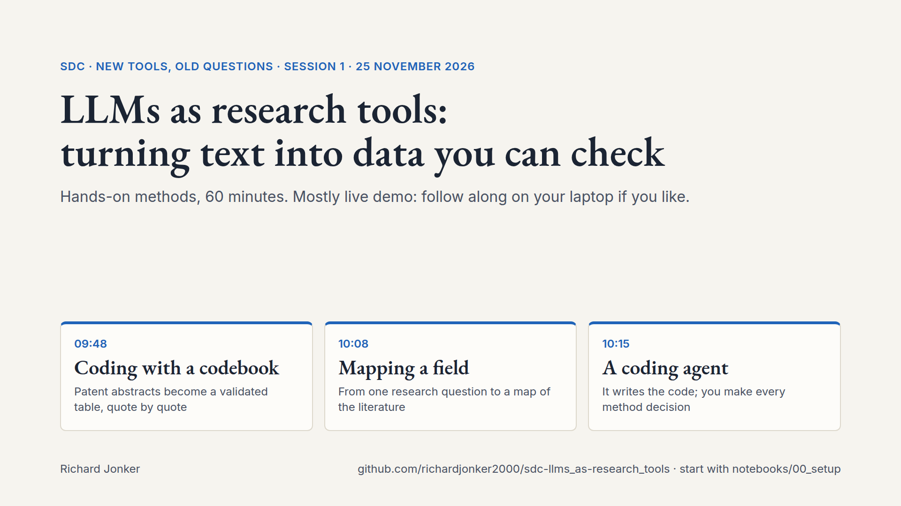
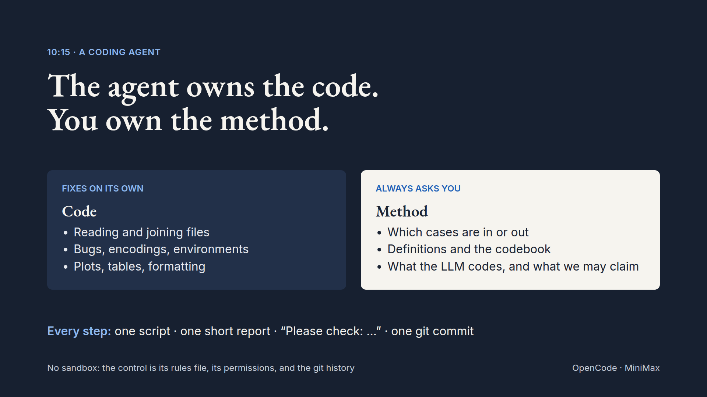

# Presenter guide: Session 1, 09:45–10:45

Richard's script for the hour: what to open, what to type, what to say. Every prompt the session uses is copied here, so this page is all you need on stage. The minute-by-minute agent sheet with fallbacks is `lesson2_agentic_coding/demo/DEMO.md`; timing and likely questions are in `docs/facilitator_notes.md`.

| Time | Block | Open |
| --- | --- | --- |
| 09:45 | Welcome | slide 1 |
| 09:48 | Coding with a codebook (20 min) | `lesson1_text_to_data/01_codebook_extraction.ipynb` |
| 10:08 | Mapping a field (7 min) | `lesson1_text_to_data/08_bibliometrics.ipynb` |
| 10:15 | A coding agent (30 min) | slide 2, then the terminal |
| 10:45 | End | – |

---

## The day before

```bash
cd ~/sdc/sdc-llms_as-research_tools && git pull
./setup.sh --reset-demo --cache-from <MiniPC>:~/projects/sdc_work/outputs_cached
git clone lesson2_agentic_coding/demo/demo_prepared.bundle ~/sdc_demo_prepared
```

- [ ] `outputs_cached/` is filled. Without it, 01 and 08 call the API live or show fake answers.
- [ ] `config.env` has the **workshop** key, not Roman's. `DRY_RUN=0` for the notebooks (they replay saved answers anyway). The agent folder stays on `DRY_RUN=1`.
- [ ] Run 01 and 08 top to bottom once, so every cell is a cache hit and the figures render.
- [ ] Start the agent once (`cd ~/sdc_agent_demo && ./start_agent.sh`), so OpenCode has fetched its model list.
- [ ] The slides are open: https://claude.ai/artifact/2S1k4xWMohYDayDkTVAVwx (images in `slides/`).

**On the morning,** open: JupyterLab with 01 and 08; three terminal tabs (**live** `~/sdc_agent_demo`, **prepared** `~/sdc_demo_prepared`, and one spare); the slides.

**If the network dies:** set `DRY_RUN=1` in `config.env` and restart the kernel. 01 and 08 replay saved answers; the agent runs from the prepared tags.

---

## 09:45 · Welcome (3 min)



**Say:**
- One promise for the session: everything an LLM gives us today is something we can **check**. Not trust, check.
- Three blocks. A codebook, the same thing content analysis has always used, now applied by a model, and every answer must pass it or it goes back. Then a quick one: a map of a research field built from one question. Then the second half of the hour: a coding agent that does the programming while every method choice stays with the researcher, and we'll watch it make one mistake.
- You don't need to keep up live. Watch first; everything is in the repo and runs offline.
- This morning is about turning text into numbers you can count and check. Roman's sessions after coffee and this afternoon take the qualitative side.

---

## 09:48 · Coding with a codebook: notebook 01 (20 min)

Run the cells top to bottom; all answers come from the cache, so each cell is instant.

**1. The idea (2 min).** Show the flow diagram. *"A codebook is a list of variables, each with a definition and allowed values. The model fills it in; the helper validates the answer; errors go back for another try."*

**2. The codebook (4 min).** This is the prompt. Read the `description=` lines aloud: they are the coding instructions.

```python
Domain = Literal["health", "finance", "manufacturing", "transport", "energy",
                 "retail & consumer", "ICT & telecom", "other"]

class PatentCode(BaseModel):
    is_ai: bool = Field(description="True if the invention uses or improves artificial intelligence or machine learning")
    technology: str = Field(description="The core technology in 2 to 5 words")
    problem_solved: str = Field(description="The problem the invention solves, in one short sentence")
    application_domain: Domain = Field(description="The main sector where the invention is used")
    automation_vs_augmentation: Literal["automates human work", "augments human work", "neither"]
    evidence_quote: str = Field(description="A phrase of 3 to 12 words copied word for word from the abstract that best supports your is_ai answer. Never empty.")
```

```python
INSTRUCTIONS = """You are a research assistant coding patent abstracts for an innovation study.
Read the patent abstract and fill in every field of the codebook. Base your answers only on the text."""
```

**3. The rest of the prompt (2 min).** *"Your instructions are only part of what the model sees. Nothing is hidden: here is the whole wrapper."*

```python
TEMPLATE = '''{instructions}

Return ONLY one JSON object, no other text, matching this JSON schema:
{schema}

TEXT:
"""
{text}
"""'''

RETRY = """That answer was not valid:
{error}
Return ONLY the corrected JSON object."""
```

**4. One abstract, under the hood (3 min).** Step 2 shows the raw answer (JSON in a code fence) next to the validated row. *"The model thinks in tags and markdown; we don't care. What we get is a typed record that either passes the codebook or gets sent back with the error."*

**5. Thirty abstracts (3 min).** Step 3: `failed rows: 0`. In the saved answers, 11 of 30 are coded AI, 18 "automates human work", 12 "neither". *"Same pipeline at 30 or 30,000."*

**6. Did it invent its evidence? (3 min).** Step 4: in the saved answers, **0 of 30** quotes are missing from the abstracts. *"Zero today, with this model. It isn't always zero, and you can only know because we asked for a verbatim quote, so one line of code can check it. Most published LLM studies skip this check."*

**7. The figure (2 min).** *"Text, to codebook, to validated table, to figure. With 30 patents it's a demonstration, not a finding."*

**8. Try it yourself (1 min, mention only).** Add a field such as `uses_personal_data: bool = Field(description="True if the invention processes data about individual people")` and re-run Steps 1–3. Leave it to them.

---

## 10:08 · Mapping a field: notebook 08 (7 min)

Use the pre-run example `RESEARCH_QUESTION = EXAMPLES["fdi_spillovers"]` (cached, works offline). Run everything beforehand; on stage scroll and talk. Show four things only:

**1. The question gets rewritten (1.5 min), Step 0a.** Point at what it **sets aside** and the **other readings**.

```python
REWRITE_INSTR = ("A PhD student will map the existing literature around their research question. Rewrite the question so "
                 "it works well for a literature search: keep the student's intent, fix spelling, keep ONE core question, "
                 "and use the established terms of the field rather than everyday wording. The rewritten question should "
                 "name the general phenomenon; list the specific setting (industry, country, population, policy) under "
                 "setting. Methods, data and secondary sub-questions go under set_aside.")
```

**2. The search query checks itself (1.5 min), Step 0b.** *"Propose a query, count the hits in OpenAlex, feed the count back, refine. That loop is a small agent."*

```python
PLAN_INSTR = ("A PhD student wants to map the literature around their research question. Turn it into a search plan for "
              "OpenAlex, which searches titles and abstracts. The query should find the SURROUNDING FIELD, not only papers "
              "answering this exact question: a few hundred to a few thousand articles. Leave out the country, the data and "
              "the method unless they are the core topic; those details go in the project description.")
```

**3. Streams and the map (2 min), Steps 4–6.** Clustering finds the streams; the LLM only names them. *"You stay the judge: check the names against the profiles."*

```python
INSTR = ("Below are the research streams of a bibliometric map of one field. Name every stream. The names must be "
         "clearly DIFFERENT from each other: use the distinctive words and the period, not generic labels.")
```

**4. Chat with the literature (2 min), Step 10.** Show one answer with [ID] citations, and the check that every cited ID was among the 8 sources. *"An answer that cites anything else is invented."*

```python
ASK_SYSTEM = ("You answer questions about a research literature using ONLY the numbered sources given "
              "(titles and abstracts). Cite every claim as [ID] with the source IDs exactly as given. "
              "If the sources do not answer the question, say so plainly instead of guessing. "
              "Note where sources disagree. Be concise: at most 250 words.")
```

Skip `suggest_questions` (`SUGGEST_INSTR`) if short of time. Bridge: *"So far the LLM filled in forms we wrote. Now we let one write the code."*

---

## 10:15 · A coding agent (30 min)



**Slide (1 min). Say:** *"There's no sandbox here. The control is three things: a rules file that says who decides what, a permission list (no web, it can't delete files, it can't read the API key, it can't rewrite history), and git, which records every step. Left: what it does without asking. Right: what it must ask. If it's unsure which side something is on, the rule says it is method, so it asks."*

**0–3 min · The rules.** In the live folder show `AGENTS.md` and `opencode.json`. *"An instruction is a request; a permission is enforced."* Be honest: it may run Python, and Python can open any file, so these are guard rails plus a record, not a sandbox.

**3–7 min · Plan.** Type (about 2 min):

```
/plan I study how AI changes work. I want to know whether AI patents more often automate human work or augment it, and whether that has changed over time. I have the patent data from the workshop (data/patents.csv) and the LLM codes from notebook 01 (data/patent_codes.csv). I am not good at Python.
```

Narrate: it writes one script to look at the data before proposing. Open `PLAN.md`, point at "What this data can and cannot answer". *"It is looking before it proposes."*

**7–11 min · The room decides.** Read out D1–D3, take a show of hands, then type the answers. In the prepared run they were:

```
/revise D1: b, code the other 121 with the same codebook. The 30 in notebook 01 were a random sample (patents.sample(30, random_state=1)). D2: a as the headline, b as a labelled secondary. By neither I mean the patent has no work content at all. D3: a, and b only if the cells allow it.
```

*"Method questions. It recommends; it doesn't decide."*

**11–15 min · One step.**

```
/next
```

Open `outputs/analysis_dataset.csv`, read its "Please check:" line. *"One step, one report, one commit."*

**15–18 min · Explain.**

```
/explain
```

*"If you can't follow the explanation, don't accept the step."*

**18–23 min · The tricks.** Type, then while it runs (about 1.5 min) show the prepared diagram (prepared tab: `git checkout t4-diagram`, open `outputs/extras/pipeline.svg`):

```
/extra Make a LaTeX table for my paper: of the 30 coded patents, how many were labelled automates / augments / neither, split by whether the LLM flagged them as AI. Counts and row percentages.
```

Other extras that work: `/extra Make a diagram of the pipeline from the patents to the codes to the table, with the counts on the boxes.` *"The boring parts of a paper are the parts it's best at."*

**23–26 min · Spot the bug.** Prepared tab: `git checkout t5-latex`, show `outputs/extras/automation_by_ai.tex`. Ask the room what's wrong. (`9 (81.8)\%`: the percent sign is outside the bracket, and the agent reported "checked".) Then `git checkout t7-fix`: fixed, and its script now checks formatting too. Don't run the fix live (5 min). The prompt it got:

```
/extra In outputs/extras/automation_by_ai.tex the percent sign is outside the bracket: it reads 9 (81.8)\% and should read 9 (81.8\%). Fix the script that makes the table, regenerate it, and check the formatting this time, not only the numbers.
```

*"It checked the numbers, not the formatting. Checking is still your job."*

**26–28 min · Wrap-up.** `git log --oneline`: every step is a commit you can read or undo. The next step, coding the other 121, waits for **you** to set `DRY_RUN=0`: the agent can't decide to spend money.
**Delegate:** environments, bugs, plots, formatting. **Never delegate:** the sample, definitions, the codebook, the claims.

**28–30 min · Questions.** Hand over: coffee at 11:00, Roman at 11:15.

### If the agent misbehaves

| What happens | What to do |
| --- | --- |
| No output for about 60 s | Ctrl-C, start again, or switch to the prepared tag for that step |
| A permission dialog pops up | Click **deny**: that's the rule working, say so |
| No network, or the key fails | Run from the prepared tags `t1-plan` … `t7-fix` and read from `lesson2_agentic_coding/demo/transcripts/` |
| It asks different decisions than D1–D3 | Good: answer those. The prepared tags still match the run sheet |
